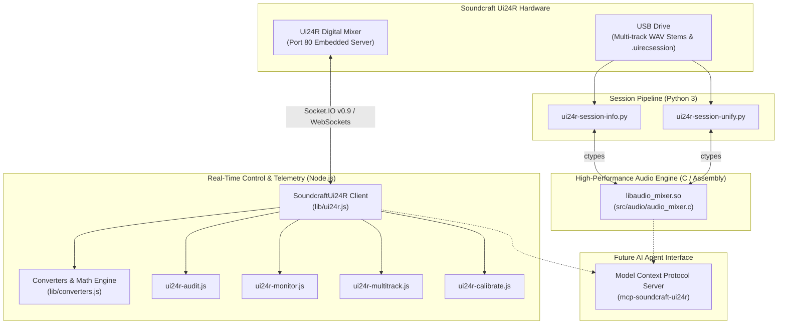
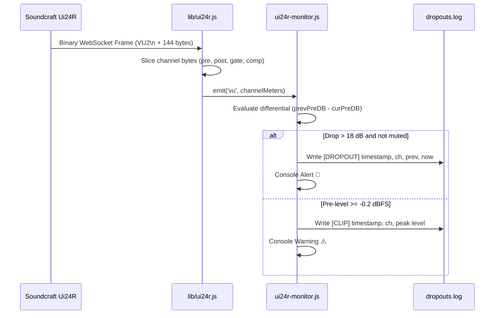
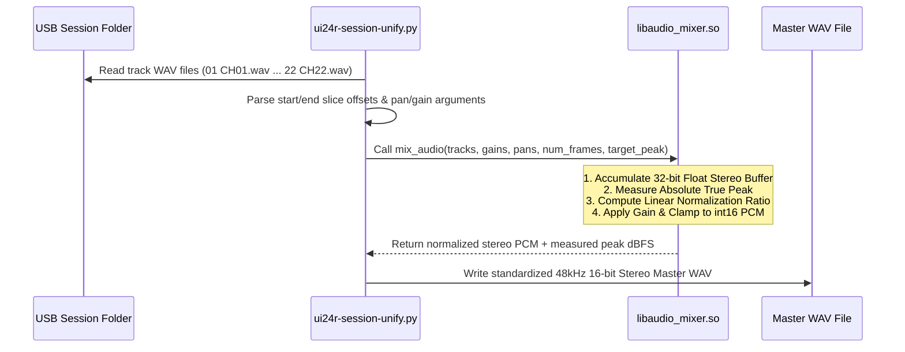

# System Architecture & Technical Design

This document details the software architecture, data flow pipelines, and component hierarchy of the **Soundcraft Ui24R Tools Suite**.

---

## 1. Architectural Overview

The suite is engineered as a three-tier system combining real-time network telemetry, high-performance native DSP audio processing, and offline session manipulation:

---

## 2. Component Breakdown

### 2.1 Real-Time Control & Telemetry Layer (`Node.js`)

- **`lib/ui24r.js`**: Core networking driver. Implements the Socket.IO v0.9 HTTP handshake, WebSocket connection upgrade, bidirectional frame parsing, automatic keep-alive heartbeats (`2::`), parameter cache synchronization, and binary VU meter stream slicing.
- **`lib/converters.js`**: Mathematical parameter translation. Decodes raw binary VU bytes into normalized ranges, converts slider positions (0.0–1.0) into logarithmic decibel values (dBFS), and maps Studer analog preamp gains using a 64-step discrete ladder table.
- **`bin/ui24r-audit.js`**: Passive inspector that connects, waits for full state dump, samples live telemetry over 3 seconds, and formats a channel matrix including gain, faders, mute state, EQ/dynamic bypass flags, and peak signal levels.
- **`bin/ui24r-monitor.js`**: Continuous daemon monitoring all 24 channels at ~25 frames per second. Analyzes pre-fader and post-fader dynamics to detect RF microphone dropouts, aggressive noise gate truncations, signal dips (>18 dB within 120 ms), and digital clipping (≥ -0.2 dBFS).
- **`bin/ui24r-multitrack.js`**: Multi-track USB recording manager. Arms only unmuted live channels (`arm-live`), arms specific channels (`arm-channel`), checks flash drive free space, and safely stops recording with a mandatory 5-second buffer flush.
- **`bin/ui24r-calibrate.js`**: Automated DSP channel staging. Injects tuned speech or vocal compression, noise gate bypass, and high-pass filtering (HPF) directly into DSP memory.

---

### 2.2 Native Audio Summing & Normalization Engine (`C`)

To process gigabytes of 24-channel uncompressed 48 kHz / 16-bit PCM audio with near-instantaneous speed, dynamic summing and stem analysis are implemented in native C (`src/audio/audio_mixer.c` compiled into `build/libaudio_mixer.so`).

#### Key Engine Features:
1. **Constant-Power Pan Law (-3 dB Center):**
   Stereo panning calculates smooth equal-power gains based on trigonometric curves:
   $$\theta = \frac{\pi}{4} \cdot (pan + 1.0)$$
   $$gain_L = \sqrt{2} \cdot \cos(\theta) \cdot gain_{track}$$
   $$gain_R = \sqrt{2} \cdot \sin(\theta) \cdot gain_{track}$$

2. **64-Bit Float Accumulation & Double-Precision Normalization:**
   Prevents interim rounding distortion and clipping when summing up to 24 tracks simultaneously.

3. **Peak & RMS Telemetry Extraction (`analyze_track_stats`):**
   Scans raw PCM buffers sequentially using pointer increments, achieving execution speeds exceeding 1 GB/s.

---

### 2.3 Multi-Track Session Pipeline (`Python 3`)

- **`bin/ui24r-session-info.py`**:
  Inspects recorded sessions created on the USB drive. Parses `.uirecsession` XML/JSON metadata, loads individual channel tracks, queries the native C library for peak and RMS levels, and generates an audit table of active vs. silent channels.
- **`bin/ui24r-session-unify.py`**:
  Production multi-track unifier. Slices sessions by time range (`--start` / `--end`), applies individual channel pan positions and gain multipliers, excludes ambient or muted tracks, normalizes to a target peak (e.g. -1.0 dBFS), and exports radio-ready stereo/mono WAV masters.

---

## 3. Data Flow Pipelines

### 3.1 Real-Time Drop & Clipping Detection Pipeline

---

### 3.2 USB Multitrack Summing & Normalization Pipeline

---

## 4. Safety & Operational Constraints

1. **Virtual Soundcheck Lockout:**
   The parameter `var.mtk.soundcheck` must never be set to `1` during live productions. When active, it switches the mixer to playback mode, which mutes all live inputs from the stage. All multitrack tools enforce verification of this parameter.
2. **Buffer Flush Delay:**
   Writing uncompressed 24-track audio to USB flash memory requires active buffering. Stopping recording requires a 5-second wait for `var.mtk.busy` to return to `0` before unmounting or pulling the USB drive.
3. **Hardware Memory Isolation:**
   Compilation of the native C shared library uses a dedicated local build directory (`TMPDIR = $(CURDIR)/build`) to prevent quota or tmpfs limits on restricted host machines.
